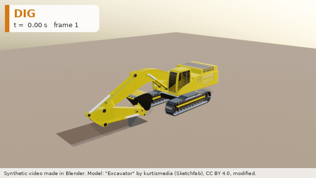

# Synthetic-to-Real Construction Activity Recognition

**Can synthetic video teach a model to recognise what an excavator is doing on a real construction site?**

> **Status (16 Nov 2026):** Phase 1 complete (tag `v0.1-phase1`): excavator
> detector, ByteTrack tracking and a rule-based active/idle demo. Phase 3 in
> progress: the Blender generator has produced its first physics-checked,
> automatically labelled clip (tag `v0.2-first-clip`, below). No model has
> been trained on synthetic video yet.



*The first synthetic clip (14.4 s): every frame carries its activity label, written by the
generator, and every pose stays inside the machine's physical limits. Details in
[Phase 3: first synthetic clip](#phase-3-first-synthetic-clip-7-nov-2026).*

---

## Motivation

For more than ten years I worked in project control and cost engineering on
major road-infrastructure projects in Colombia, including the Toyo and La
Línea tunnels. Idle machinery and unrecorded labour were measured mostly by
manual reports — slow, incomplete and hard to audit. This project is my
attempt to replace that manual process with an objective, video-based record
of what machines and workers are actually doing, so productivity control and
public-works transparency can rest on evidence instead of paperwork.

---

## Research questions

The first preprint answers questions 1 and 2 and gives a first answer to
question 4. Question 5 belongs to the thesis stage.

1. **Transfer.** Can video models trained mainly on Blender-generated,
   automatically labelled clips recognise five excavator activities in real
   site footage, and where do they fail?
2. **Real-data savings.** Under a fixed training budget, how does accuracy on
   real footage change when real clips replace synthetic ones, and how many
   real labelled clips does a large synthetic set save?
3. **What closes the gap.** Which generation factors matter most: domain
   randomisation (viewpoint, lighting, weather, background, distractors) or
   generative realism enhancement of the rendered clips?
4. **Specialist or generalist.** On the same real test set, how does the
   synthetic-trained model compare with a zero-shot vision-language model, and
   with a pre-trained video model fine-tuned on real clips only, in accuracy,
   speed and cost?
5. **Activities as crews (thesis stage).** Does modelling an operation as
   interacting resources, starting with an excavator and the trucks it loads,
   recognise operation states better than separate machine models?

---

## Scope

The first version studies **one hydraulic excavator and five activities**:
digging, swinging, dumping, travelling and idle. The trucks it loads follow in
the thesis, and workers and materials later.

---

## Pipeline

```
Scenario design  →  Synthetic clips   →  Train models   →  Real-site test
(Blender rig +      (labels made          (video action       (sim-to-real
 scripted acts)       free by engine)      models)              gap)
        ↑                                       ↑                    │
        └──────────── adjust randomisation & realism ────────────────┘
```

Synthetic clips and a pool of real training clips are mixed under a fixed
training budget. Every model is scored on the same held-out real test set.

---

## Method

- **Baseline (Phase 1, done):** YOLOv8s excavator detector, ByteTrack
  tracking, and a motion rule that labels each moment as active or idle.
- **Synthetic generator (Phase 3, in progress):** Blender Python scripts
  drive a rigged excavator through work cycles with random timing. Every pose
  is checked against the machine's physical limits, the strokes of its
  hydraulic cylinders and the bucket's range against the stick, because the
  cylinder lengths set the joint angles ([Koivo, 1992](https://www.iaarc.org/publications/fulltext/Planning_for_automatic_excavator_operations.PDF)). Every frame gets its
  activity label automatically. Next: export bounding boxes and masks
  (BlenderProc is one option), and randomise camera viewpoint, lighting,
  weather, terrain, background, motion blur and video compression per clip.
  Target: about 2,000 clips of 2 to 4 seconds.
- **Realism enhancement (research question 3):** a structure-conditioned
  diffusion model (ControlNet approach) refines rendered frames while keeping
  their labels.
- **Recognition models (Phase 5):** X3D and VideoMAE, pre-trained on Kinetics
  and fine-tuned on tracked excavator clips.
- **Comparison models (research question 4):** a zero-shot vision-language
  model run locally (for example Qwen2.5-VL), and a VideoMAE model fine-tuned
  on real clips only.
- **Evaluation:** one held-out real test set, split by source video. Macro-F1
  over the five activities is the main metric. Every configuration runs with
  at least three random seeds, reported as mean ± standard deviation, with 95%
  bootstrap confidence intervals that resample whole source videos.

---

## Data

| Phase | Data | Status |
|---|---|---|
| Phase 0 | Pretrained COCO model, public sample image | Done |
| Phase 1 | Excavators dataset (Roboflow Universe, version 3, CC BY 4.0), three classes: excavator, dump truck, wheel loader. Two public test videos (Pexels, Pixabay) for tracking and the active/idle rule | Done |
| Phase 3 | About 2,000 synthetic excavator clips (2 to 4 s), generated in Blender | First clip done (dig and swing, 14.4 s); full set planned |
| Phase 4 | About 800 real clips (2 to 4 s) cut from at least 45 minutes of public video from 20 or more sources; activity start and end times labelled by hand; split by source video into about 400 test, 300 training-pool and 100 validation clips | Planned |

All data is public or synthetic. Real footage is used only when its licence
allows research use, or with site permission. Identifiable people are avoided
and faces are blurred where relevant. Video sources are listed in
[EXPERIMENTS.md](EXPERIMENTS.md).

---

## Phase 1 results

Full settings and observations for every run are in
[EXPERIMENTS.md](EXPERIMENTS.md).

**1. Excavator detector (6 Oct 2026).** YOLOv8s pretrained on COCO,
fine-tuned for 5 epochs; validation split of 267 images.

| Class | Instances | Precision | Recall | mAP50 | mAP50-95 |
|---|---|---|---|---|---|
| all | 426 | 0.945 | 0.737 | 0.863 | 0.630 |
| EXCAVATORS | 36 | 0.884 | 0.694 | 0.797 | 0.532 |
| dump truck | 212 | 0.971 | 0.622 | 0.832 | 0.630 |
| wheel loader | 178 | 0.980 | 0.893 | 0.959 | 0.727 |

The validation split holds only 36 excavator instances, so the excavator
scores are noisy.

**2. Tracking (9 Oct 2026).** ByteTrack on a 25-second public excavator
video. The excavator was detected in every frame with no class flicker, but a
duplicate box on the same machine created a second track ID for 5 seconds,
and the track then continued under the new ID. A machine-hours count would
have counted two machines.

**3. Active/idle rule (14 Oct 2026).** The motion score is the change in the
tracked box (centre, width and height) over half a second, divided by the box
diagonal. Threshold τ = 0.02; minimum durations 1.5 s active and 2.0 s idle.
On a 23.6-second fixed-camera clip of a working excavator, the rule labelled
all scored time as active, with no false idle. Idle detection is not tested
yet, because the clip has no idle period.

**Open issues**
- Retrain the detector for 50 epochs and compare with the 5-epoch run.
- Duplicate boxes appeared in both videos: test confidence 0.25 and the
  50-epoch detector.
- Calibrate τ on a longer fixed-camera clip that includes idle periods.

---

## Phase 3: first synthetic clip (7 Nov 2026)

One dig and one loaded 90° swing: 360 frames at 25 fps (14.4 s), random seed 1,
shown at the top of this page. Full settings and the history of the three
tests are in [EXPERIMENTS.md](EXPERIMENTS.md).

| Part | What the generator does | Result of the checks |
|---|---|---|
| Motion | One control point moves the bucket pin; inverse kinematics moves the boom and the stick. Five dig steps (reach, lower, fill, curl, lift) and a 90° swing, each with a random duration | The bucket pin reached its target at every frame (largest gap 0.0 cm) |
| Physical limits | The hydraulic cylinder lengths set the joint angles ([Koivo, 1992](https://www.iaarc.org/publications/fulltext/Planning_for_automatic_excavator_operations.PDF)). The bucket's range against the stick and the strokes of the three cylinders were measured from the model itself | Bucket curl −112.9° to 0° (allowed −141° to +17.8°); boom, stick and bucket cylinders inside their strokes at every frame |
| Site practice | A full bucket is closed until its tip line (bucket pin to teeth tip) is level, and kept level through the lift and the swing, so wet material does not spill | Tip line within 2.1° of level from the end of the curl to the end of the swing |
| Scene | A ground with a 1.2 m pit in front of the machine, so the bucket digs into visible soil | The bucket and the stick never entered the ground outside the pit |
| Labels | The script writes the activity of every frame | dig: frames 1–251; swing: frames 252–360 |

Two earlier tests failed, and each failure added a check. Test 1 asked for a
lift the arm could not reach (the bucket pin missed its target by 42 cm).
Test 2 turned the bucket 37° past the point where it touches the stick, and
buried it 1 m under a flat ground.

**Not done yet:** bounding-box and mask export, randomisation, the dump,
travel and idle activities, the real test set (Phase 4) and any training on
synthetic clips.

**Model credit:** ["Excavator"](https://sketchfab.com/3d-models/excavator-f2a569f2a2f64a079cc353fa4d4a74f1)
by kurtismedia, licensed under
[CC BY 4.0](https://creativecommons.org/licenses/by/4.0/). Modified for this
project: animated with Python scripts in Blender to generate synthetic
training video. The model file is not stored in this repository; see
[assets/excavator/SOURCE.md](assets/excavator/SOURCE.md).

---

## Compute

Local development and training on a MacBook Pro (Apple M4 Pro) with PyTorch
MPS (Metal Performance Shaders); free Google Colab or Kaggle GPUs for heavier
training.

---

## How to run

**Phase 0 notebook (Google Colab)**

1. Open `notebooks/01_pretrained_demo.ipynb` in Google Colab:
   [Open in Colab](https://colab.research.google.com/github/icmoralesb/synthetic-data-for-construction-activity-recognition/blob/main/notebooks/01_pretrained_demo.ipynb)
2. Set the runtime to GPU (*Runtime → Change runtime type → T4 GPU*).
3. *Runtime → Run all*. It installs Ultralytics, loads a pretrained model, and
   runs detection on a sample image and on a construction photo you upload.

**Phase 1 (local)**

```bash
conda env create -f environment.yml
conda activate construction-cv
python scripts/active_idle_B.py
```

Set the paths to the trained weights and to the video at the top of
`scripts/active_idle_B.py`. Model weights and videos are not stored in this
repository, because of their size and licences. Without conda, install the
packages with `pip install -r requirements.txt`.

**Phase 3 (Blender 4.2)**

1. Download the excavator model from the link in
   [assets/excavator/SOURCE.md](assets/excavator/SOURCE.md) and save it as
   `assets/excavator/excavator_1.blend`.
2. Open it in Blender 4.2. In the *Scripting* tab, open
   `scripts/blender/dig_swing.py` and press *Run*. It keys the dig and the
   swing, runs every check, and writes `data/renders/dig_swing_report.txt`.
3. Open `scripts/blender/render_gif.py` and press *Run*. With
   `PREVIEW = True` it renders one test picture per key frame; with `False`,
   every second frame.
4. Close Blender with *Don't Save*: the scripts change the file only in memory.
5. Outside Blender, label the pictures and make the GIF:
   `python3 scripts/blender/make_gif_labels.py data/renders/gif_test3 data/renders/gif_labelled`,
   then the two `ffmpeg` commands written at the top of that script.

---

## Roadmap

- [x] **Phase 0** (1 Oct 2026) — repository and pretrained-pipeline sanity check
- [x] **Phase 1** (October 2026, tag `v0.1-phase1`) — excavator detector, tracking, active/idle demo
- [ ] **Phase 2** (8–28 Oct 2026) — literature review and novelty check
- [ ] **Phase 3** (started 22 Oct 2026; first clip 7 Nov 2026, tag `v0.2-first-clip`) — synthetic pipeline in Blender (about 2,000 clips)
- [ ] **Phase 4** (1–8 Nov 2026) — real data: about 800 clips from long public videos
- [ ] **Phase 5** (9–19 Nov 2026) — experiments: synthetic only, real-data replacement and savings curves, zero-shot comparison
- [ ] **Phase 6** (20 Nov – 10 Dec 2026) — paper writing (6–8 pages, LaTeX)
- [ ] **★ Repository citable** (3 Dec 2026) — release v1.0: generator, dataset sample, results
- [ ] **★ arXiv preprint submitted** (13 Dec 2026, buffer to 10 Jan 2027)

Phase 3 is taking longer than planned, so the dates of Phases 4 to 6 and of the
two milestones are being re-planned.

---

## Use of AI tools

Parts of the code and documentation in this repository, including the Phase 0
notebook and the Blender scripts, were drafted with the help of an AI assistant (Claude, by
Anthropic). I ran every script and notebook myself, and all reported results
come from my own runs.

---

## Author

Iván Camilo Morales Buitrago — civil and cost engineer moving into applied
computer vision for construction, preparing a research master's application
for 2027.
GitHub: [@icmoralesb](https://github.com/icmoralesb)

## Licence

MIT — see [LICENSE](LICENSE).
